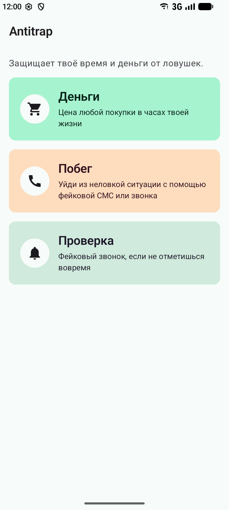
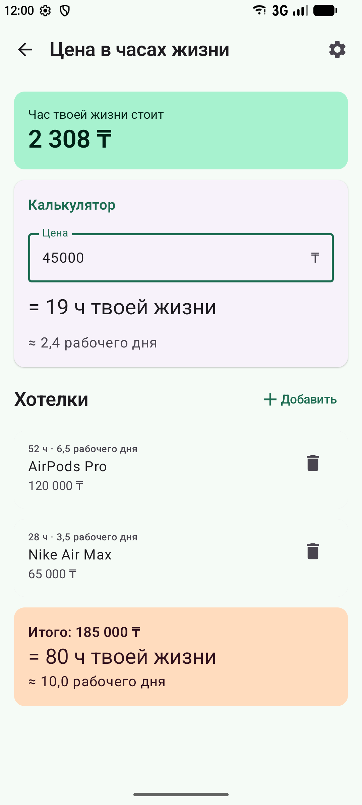
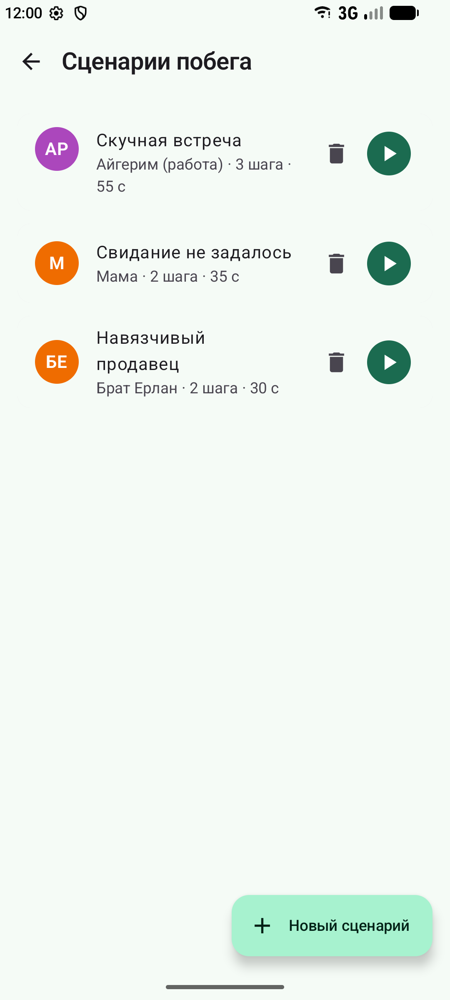
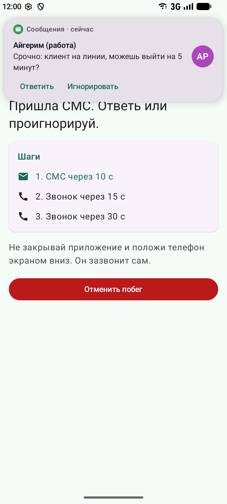

# Antitrap

Antitrap is an Android app that protects your money and your time.
It shows how many hours of work a purchase really costs, and it helps you leave an awkward situation with a fake SMS or phone call.

## Screenshots

| Home | Money | Scenarios |
|------|-------|-----------|
|  |  |  |

| Fake SMS | Fake call | Check-in |
|----------|-----------|----------|
|  |  |  |

## Features

**1. Price in life hours**
- Enter your monthly income and working hours per week. The app calculates how much one hour of your work is worth.
- Type any price and see it in hours and work days, for example "= 19 h of your life".
- Keep a wishlist. Every item shows its cost in hours, and the total is shown at the bottom.

**2. Escape scenarios**
- Create, edit and delete scenarios. A scenario has a title, a caller name, an SMS text, a "legend" (what to tell people) and a list of steps.
- Each step is an SMS or a call that comes after a delay.
- Three ready scenarios are added on first launch.
- When you run a scenario, the app shows a fake SMS banner and then a fake incoming call with the system ringtone and vibration.
- If you answer, you get a call screen with a timer. After the call, the app shows the legend.
- You can cancel the escape at any time.

**3. Check-in**
- Choose a time and a scenario.
- If you don't press "I'm OK" before the time runs out, the scenario starts by itself.

## Architecture

```
domain/  data classes and pure logic (hourly rate, validation, timers)
data/    repository interfaces and in-memory implementations
ui/      screens, ViewModels, reusable components, theme, navigation
```

- **Navigation:** Navigation Compose with routes in `Routes.kt`. The scenario editor gets `scenarioId` as an argument.
- **ViewModels:** each screen has a ViewModel with a `StateFlow`. Screens read it with `collectAsStateWithLifecycle()`.
- **Escape and check-in** use ViewModels scoped to the Activity, so they keep running when you rotate the phone or change screens. The escalation runs as a coroutine.
- **Compose state:** forms use `rememberSaveable`, and reusable components are stateless (state hoisting).
- **Configuration changes:** timers store a timestamp, not "seconds left", so rotation does not break them.
- No database or network yet. Repositories are behind interfaces, so a database can be added later.

## How to run

1. Open the project in Android Studio (**File → Open**).
2. Wait for Gradle sync to finish.
3. Select an emulator or a phone with Android 8.0 (API 26) or newer.
4. Press **Run**.
